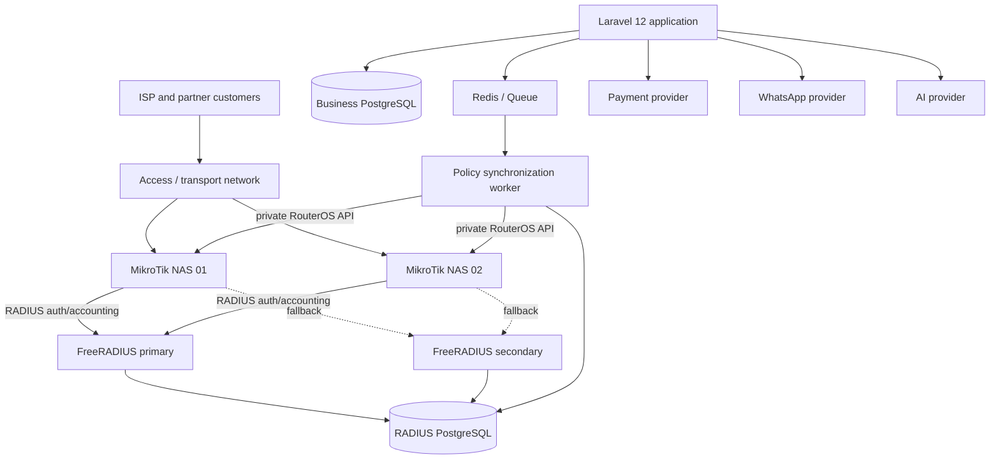

# 02 — Backend & Infrastructure Architecture

## 1. Architecture decision
Use a **Laravel 12 modular monolith** for all business domains. Run FreeRADIUS and network adapters as separate infrastructure processes. Do not split the Laravel application into microservices for MVP. Separate deployable processes are justified for queue workers, scheduled jobs, the RADIUS daemon, and network polling workers.

Primary DB: PostgreSQL. Business DB/schema and RADIUS DB/schema must be logically isolated and have separate DB roles. Prefer separate databases (`kikinet_app`, `kikinet_radius`) on PostgreSQL cluster only if load/operations permit; otherwise separate schemas and roles are acceptable. Laravel must not own FreeRADIUS internal authentication logic; it writes a controlled projection through an adapter. FreeRADIUS owns reads/writes to its accounting schema. Laravel may read accounting through read-only views/role or ingest normalized events.

## 2. Logical topology

RADIUS path and RouterOS management path are separate. RADIUS is UDP-based AAA, not an HTTP endpoint. Laravel must not send user-facing web traffic through RADIUS. RouterOS API is only available from the private management network.

## 3. Laravel bounded contexts
| Context | Responsibilities | Owns |
|---|---|---|
| Identity & Access | Users, roles, permissions, login, API tokens | users, roles, permissions, pivots, personal_access_tokens |
| Partner | Partner profile, staff, contract, approval | partners, partner_users, partner_bandwidth_contracts |
| Customer | Customer profile, contact, ownership | customers, customer_contacts |
| Catalog | Internet packages, service attributes, allowed partner offers | internet_packages, partner_package_offers |
| Subscription | Customer service lifecycle, credentials reference, package changes | subscriptions, subscription_events |
| Billing | Invoice, line snapshot, payment, refund/adjustment, reconciliation | invoices, invoice_items, payments, payment_events |
| Tax | Tax period, tax category, document, partner submission/review | tax_periods, tax_submissions, tax_submission_items |
| Network Access | Network desired state, credentials projection, policy sync/outbox | network_access_profiles, network_access_assignments, radius_sync_outbox |
| Network Accounting | Session read model, normalized samples, daily usage, queue samples | radius_sessions, radius_accounting_samples, usage_daily, queue_samples |
| Notification | WhatsApp messages/templates/outbox/provider events | notification_outbox, notification_attempts |
| Public Invoice | Token issuance, public invoice projection and revocation | invoice_access_tokens |
| Audit | Sensitive action events and actor attribution | audit_logs |

Modules can live in `app/Domain/<Context>` or `app/Modules/<Context>`; select one convention after inspecting the repo. Do not move all current files in a large refactor. Wrap legacy controllers/repositories incrementally.

## 4. Integration boundaries
Use application interfaces to decouple business from vendors and network details:
- `NetworkAccessGateway`: `provision`, `suspend`, `restore`, `changeProfile`, `disconnect`, `getStatus`.
- `NetworkAnalyticsReader`: `customerUsage`, `partnerUsage`, `activeSessions`, `throughputSeries`.
- `PaymentGateway`: `createPayment`, `verifyWebhook`, `queryPayment`, `refund` (only if provider supports it).
- `WhatsAppGateway`: `sendTemplate`, `sendText`, `getMessageStatus`.
- `AiAssistant`: read-only scoped answer generation; no direct mutation tools in MVP.

All interface implementations must be injectable. Provide `FakeNetworkAccessGateway`, fake payment and fake WhatsApp adapters for tests. Do not instantiate vendor SDKs inside controllers.

## 5. Network command consistency
When business transaction changes subscription/payment status:
1. Save business state and `radius_sync_outbox` command in the same DB transaction.
2. Commit.
3. Queue worker claims command with lock and idempotency key.
4. Adapter applies versioned policy to RADIUS projection and required MikroTik action.
5. Record result and external IDs; retry transient errors with exponential backoff and jitter.
6. After max attempts, move to `dead_letter`, alert central operators, and show pending sync state in UI.

Outbox command fields: `id`, `aggregate_type`, `aggregate_id`, `partner_id`, `command_type`, `payload_json`, `policy_version`, `idempotency_key`, `status`, `attempts`, `available_at`, `locked_at`, `processed_at`, `last_error`, timestamps. Unique index on `idempotency_key`. Worker must ignore stale version commands where a newer policy version exists.

## 6. Deployment components
- Web/app: Nginx + PHP-FPM + Laravel.
- Queue workers: separate supervisor/systemd process group for default, integration, notifications, analytics queues.
- Scheduler: one elected scheduler instance (`schedule:run` cron or `schedule:work`); avoid duplicate schedules without locks.
- Redis: cache, queue, rate limiting and short-lived locks.
- PostgreSQL: business DB; restricted radius DB/schema access.
- FreeRADIUS Primary + Secondary: separate hosts/VMs or failure domains where affordable.
- MikroTik NAS: one or more central-controlled access concentrators; each registered with unique shared secret and restricted source IP.
- Metrics/logging: central log sink, app error reporting, queue health, RADIUS service health, NAS reachability.
- Backup: encrypted database backups and router config backups to storage separate from the primary compute node.

## 7. API bootstrap
Create `routes/api.php` only after confirming the current Laravel bootstrap configuration. Laravel 12 applications may need `php artisan install:api` or explicit API route registration through `bootstrap/app.php`. Preserve existing web/session authentication. Use Sanctum for mobile/third-party bearer tokens; use first-party cookie/session + CSRF for same-site browser app where appropriate. Token abilities are not a replacement for policies or tenant record checks.

## 8. Failure behavior
| Failure | Expected behavior |
|---|---|
| App DB down | Business writes fail closed; queue jobs pause; no fake payment/service success |
| RADIUS primary down | NAS tries configured secondary; alert central ops |
| Both RADIUS nodes down | New PPPoE auth can fail; existing sessions may remain, but availability is not guaranteed |
| MikroTik API down | Store command as retryable; do not claim applied; RADIUS policy still controls new auth if DB sync succeeded |
| Payment provider timeout | Mark payment pending/unknown; query/reconcile; do not activate until verified |
| WhatsApp outage | Queue and retry; billing/network lifecycle continues |
| Accounting gap | Mark usage estimate/incomplete; reconcile from available counters; never fabricate exact usage |
| Queue cap not applied | Raise critical alert; central operator intervention; do not report policy as enforced |

## 9. Security zones
- Public zone: web frontend, public invoice route, payment callback endpoint.
- Application private zone: Laravel, workers, Redis, business DB.
- Management private zone: MikroTik API, router management hosts, VPN.
- AAA private zone: RADIUS UDP ports 1812/1813 and restricted database connection.
- Observability zone: logs/metrics with PII minimization.

Firewall allowlists must explicitly define source/destination/port. Never expose RouterOS API or RADIUS to the public internet. Use unique RADIUS secret per NAS, rotation procedures, VPN/private network, encrypted backups and least-privilege DB credentials.

## 10. Scaling and analytics
For MVP, one PostgreSQL cluster may be sufficient subject to load tests. Apply indexes for partner/date/status/customer/session fields, partition high-volume accounting samples by month after measuring volume, and pre-aggregate daily usage via queue workers. Do not run a full scan of `radacct` for every dashboard render. Cache small summary windows; use cursor pagination for sessions and large datasets.

The system should separate **bytes/GB over period** from **instantaneous throughput Mbps**. Customer deltas from RADIUS and partner aggregate queue samples are separate measurements and must not be summed together.
