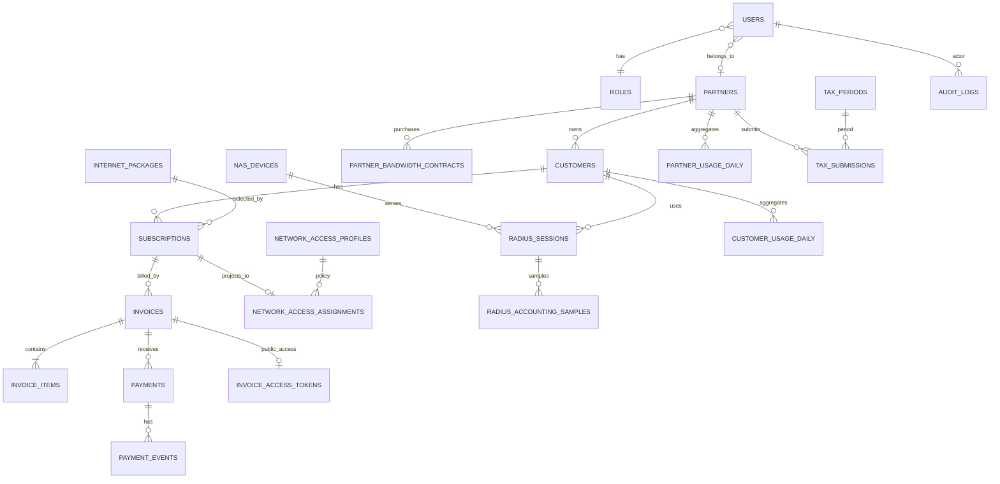

# 03 — Database ERD & Data Dictionary

## 1. Database standards
- Primary engine: PostgreSQL (aligns with repo baseline). Use UUID or BIGINT consistently after Phase 0; **recommended `bigint` identity for internal relational tables**, UUIDv7/UUID for externally exposed opaque identifiers only. Never expose sequential primary IDs as public invoice tokens.
- Table/column naming: snake_case, singular/plural convention must match current repo after audit. This target uses plural tables.
- Use `created_at`, `updated_at`; `deleted_at` only where soft deletion has a clear business reason. Financial, accounting, audit and network events should be append-only / immutable, not soft-deleted.
- Use foreign keys, check constraints, unique constraints and indexes. Avoid storing money or traffic as floating point.
- All times stored as UTC `timestamptz`; show in Asia/Jakarta. Business dates/billing periods use `date`.
- Store IDR as `bigint` whole rupiah; use `numeric(20,6)` only for rates/ratios that require precision. Bytes as `bigint` or `numeric(30,0)` when long-horizon sums may overflow.
- JSONB only for provider payload snapshots/config metadata, not as replacement for normalized relations.
- Keep RADIUS internal schema separate from business tables and DB login.

## 2. ERD (logical)

## 3. Identity and tenancy
### `users`
Existing table. Audit before alteration. Expected additions/verification: `role_id`, nullable `partner_id`/legacy `mitra_id`, `is_active`, `last_login_at`, `mfa_enabled_at`. Do not create a second tenant column if existing `mitra_id` is canonical. Choose one canonical name after audit; migration may preserve legacy name or rename with a compatibility plan.

### `roles`, `permissions`, `role_permissions`, `user_permissions`
Role definitions and granular permissions. Existing role IDs/names must be mapped, not replaced blindly. `user_permissions` supports exceptional grants/revocations only if required; default to role permission mapping.

### `partners`
Canonical partner entity (may map to existing `mitras`). Fields: `id`, `code` unique, `legal_name`, `display_name`, `tax_id` nullable, `contact_name`, `email`, `phone`, `address`, `status` (`draft|pending|active|suspended|terminated`), `approved_at`, `approved_by`, timestamps. Ensure tax/contact PII permissions.

### `partner_users`
If current `users.mitra_id` means each user belongs to exactly one partner, retain that for MVP. Create pivot only if one user legitimately operates multiple partners. Do not implement both models simultaneously. For pivot model: unique `(partner_id,user_id)`, membership role and status.

## 4. Customer and catalog
### `customers`
`id`, `customer_code` unique, `partner_id` nullable FK, `full_name`, `phone`, `email` nullable, `address_text`, `service_address_text`, `latitude`/`longitude` nullable only if needed, `identity_reference` encrypted/masked if legally required, `status`, `notes` restricted, timestamps. Avoid unnecessary sensitive identity collection.

### `internet_packages`
`id`, `code` unique, `name`, `description`, `download_mbps` numeric, `upload_mbps` numeric, `price_idr` bigint, `billing_cycle` (`monthly` MVP), `activation_fee_idr` bigint default 0, `is_active`, `tax_category_id` nullable, `created_by`, timestamps.

### `partner_package_offers`
Optional mapping of allowed retail packages by partner. Fields: partner, package, retail price override (nullable), commission rule (nullable/configurable), effective_from/to, approved_by, status. Do not allow partner to alter central package rate policy.

### `subscriptions`
`id`, `subscription_code` unique, `customer_id`, `package_id`, status, `started_at`, `next_due_date`, `billing_day` if needed, `grace_until`, `terminated_at`, `termination_reason`, `current_policy_version`, `created_by`, timestamps. A DB-level/transactional rule prevents >1 current active service per customer for same service type.

### `subscription_events`
Append-only: subscription id, from_status, to_status, event_type, effective_at, actor_type/id, reason, metadata JSONB, correlation_id, created_at.

### `subscription_changes`
Effective-dated package changes and price snapshot: subscription, old/new package, old/new price, effective date, prorate policy, approval actor, policy version.

## 5. Partner wholesale bandwidth
### `partner_bandwidth_contracts`
`id`, partner_id, contract_no unique, `max_rate_down_mbps`, `max_rate_up_mbps`, optional `committed_rate_down_mbps`, `committed_rate_up_mbps`, `monthly_price_idr`, `billing_cycle`, `oversubscription_allowed`, `effective_from`, `effective_to`, `status`, `approved_by`, `terms_document_path`, timestamps. Check committed <= max where applicable. The client must decide whether committed rate is part of the commercial offer.

### `partner_bandwidth_contract_events`
Append-only contract changes, capacity change requests and approvals.

## 6. Billing and payments — canonical database domain
The repo contains a database-oriented tagihan/pembayaran flow and a mock JSON/session billing repository. After audit, designate exactly one database-backed invoice domain. The mock path is temporary UI data only and must not create/alter invoice state.

### `invoices`
`id`, `invoice_no` unique, `customer_id`, `subscription_id`, `partner_id` nullable snapshot, `period_start`, `period_end`, `issued_at`, `due_at`, `currency` default IDR, `subtotal_idr`, `discount_idr`, `tax_total_idr`, `grand_total_idr`, `paid_total_idr` (or computed from payments), `status` (`draft|issued|partially_paid|paid|overdue|void|refunded`), `source` (`scheduled|manual|adjustment`), `idempotency_key` unique nullable, `notes_internal`, immutable snapshot metadata, timestamps. Decide whether to retain legacy `tagihans` table and adapt it or create new canonical table only after schema audit; do not create parallel billing tables without migration mapping.

### `invoice_items`
Invoice id, item code/name snapshot, description, quantity, unit price IDR, discount IDR, tax category/rate snapshot, tax IDR, line total IDR.

### `payments`
`id`, `payment_no`, invoice id, amount IDR, method, provider, provider_reference, `status` (`pending|succeeded|failed|expired|refunded|partially_refunded`), paid_at, idempotency key, created_by/system, metadata redacted, timestamps. Unique provider/reference where provider guarantees uniqueness.

### `payment_events`
Provider event ID unique, provider, payment reference, event type, signature verified flag, received_at, processed_at, payload hash, safe payload snapshot, status, error. Never store card data, secrets or full sensitive payment credentials.

### `payment_refunds` and `payment_adjustments`
Append-only records with original payment reference, amount, reason, status, actor and provider reference. Never overwrite successful payment amount to model refund.

### `invoice_access_tokens`
Invoice id, token_hash unique, expires_at, revoked_at, last_access_at, created_by, created_at. Raw token is displayed once and never persisted. Hash using SHA-256 of sufficiently random token or keyed HMAC; use constant-time comparison where applicable.

## 7. Network configuration and RADIUS projection
### `nas_devices`
`id`, `code` unique, `name`, `management_ip` private, `nas_identifier`, `site_label`, `routeros_version`, `status`, `last_seen_at`, `api_secret_reference` (vault/key reference, not plaintext), `radius_secret_reference`, `accounting_enabled`, `interim_interval_seconds`, `created_at`, `updated_at`. Secret material lives in vault/env secret manager, not DB plaintext.

### `network_access_profiles`
Versioned named speed/isolation profiles: `id`, `code`, `name`, `download_mbps`, `upload_mbps`, `mikrotik_rate_limit`, `is_isolation`, `status`, `version`, `effective_from`, timestamps. Store derived vendor attribute only after lab confirms correct direction/format.

### `network_access_assignments`
`id`, subscription_id unique current, customer_id, partner_id nullable snapshot, `nas_device_id` nullable or assigned pool, `pppoe_username` unique, `credential_reference`/protected credential fields (scheme-aware), profile_id, `desired_state`, `applied_state`, `policy_version`, `last_sync_at`, `last_error`, timestamps. Clarify whether a subscription may be moved between NAS. Do not expose password through ordinary API.

### `radius_sync_outbox`
As defined in architecture doc. Include `payload_hash`, `retry_after`, `last_attempt_at`, `correlation_id`. Unique idempotency key. Keep commands auditable.

### `network_policy_audits`
Actor, entity, old/new policy version, old/new profile, action, result, router/radius reference, reason and timestamps.

## 8. Accounting and analytics
### `radius_sessions`
Normalized read model: `id`, `nas_device_id`, `acct_session_id`, `acct_unique_id` nullable, `customer_id`, `partner_id`, `subscription_id`, `username`, `framed_ip_address`, `start_at`, `last_seen_at`, `stop_at`, `session_seconds`, `input_bytes_64`, `output_bytes_64`, `terminate_cause`, `status`, `raw_record_reference`, timestamps. Unique key scoped by NAS/session ID; session restart semantics verified.

### `radius_accounting_samples`
Append-only deduped sample: `id`, `radius_session_id`, `nas_device_id`, session key, `sampled_at`, `event_type` (`start|interim|stop`), input/output total bytes 64-bit, input/output delta bytes, `delta_valid`, `dedupe_key` unique, `counter_reset_detected`, `source_event_id` nullable, `ingested_at`. Handle out-of-order data by retaining raw sample then recomputing affected segment or flagging for reconciliation. Partition by sample month after volume assessment.

### `customer_usage_daily`
Unique `(customer_id, usage_date)` plus partner snapshot, upload/download bytes, total bytes, covered_seconds, sample_count, completeness (`complete|estimated|gap`), calculation_version, calculated_at.

### `partner_usage_daily`
Unique `(partner_id, usage_date)`, upload/download volume aggregated from customer usage, peak sampled download/upload Mbps, average measured throughput, max contract cap snapshots, utilization metrics and completeness flag.

### `router_queue_samples`
`nas_device_id`, partner or queue identity, sampled_at, queue key, current rate down/up, bytes down/up cumulative, packet/drop counters, sample interval, sample dedupe key. Keep aggregate router counters distinct from customer RADIUS counters.

### Accounting calculation
For each direction: `total_bytes = gigawords * 4294967296 + octets`. `delta = current_total - previous_total` only when sample order and session continuity are valid. Negative delta is reset/invalid unless reset/reboot handling is established. De-duplicate each event before processing. Interim totals are cumulative and MUST NOT be summed as if each were an interval. Stop sample closes session; if Stop is missing, stale-session reconciliation marks data estimated/incomplete.

## 9. Tax administration
### `tax_categories`
Configurable code/name/tax family, rate decimal, basis, effective dates, reference label, approval and active flag. Tax/legal reviewer confirms applicable values before activation.

### `tax_periods`
Period type, year/month, starts_on, ends_on, due_on, status, owner entity, notes.

### `tax_submissions`
Partner id nullable for central entity, tax period, tax category, declared base, calculated/declared amount, withheld/paid amount, reference number, submitted_at, status (`draft|submitted|needs_revision|approved|rejected|paid|closed`), reviewer, review notes, document set, timestamps.

### `tax_submission_items`
Source invoice/payment/expense reference (where in scope), amount basis, tax amount, evidence attachment, line description. Avoid double entry from invoice source data where report can be calculated.

### `tax_documents`
Submission id, storage path, file hash, MIME, size, uploaded_by, uploaded_at, retention policy. Validate uploads and scan for malware.

## 10. Notifications, public portal, audit
- `notification_outbox`: channel, recipient, template, variables, business reference, idempotency key, status, attempts, next retry.
- `notification_attempts`: provider response/status/timestamps; redact PII.
- `audit_logs`: actor type/id, action, subject type/id, before/after safe JSON, IP/device metadata, correlation ID, created_at. Never log secrets or full payment payloads.
- `integration_webhook_events`: provider, external event ID unique, payload hash, signature status, processing state, correlation ID.

## 11. Indexes / constraints baseline
- Unique global `customers.customer_code`, `network_access_assignments.pppoe_username`, `invoices.invoice_no`.
- Composite indexes `(partner_id, status, created_at)`, `(partner_id, due_at)`, `(customer_id, status)`, `(subscription_id, period_start, period_end)`, `(nas_device_id, acct_session_id)`, `(partner_id, usage_date)`, `(customer_id, usage_date)`.
- Partial unique index for one current subscription per customer/service type if PostgreSQL version and schema design support it.
- FK delete rules: financial/accounting/audit rows generally RESTRICT; use explicit cancellation/reversal rather than cascade deletes.
- Add DB check constraints for nonnegative money/bytes and date range validity.

## 12. Existing schema reconciliation checklist
Before migrations, inspect all files in `database/migrations`, corresponding models/factories/seeders, database indexes, and live-safe anonymized schema. Map existing names (`mitras`, `paket_internet`, `langganans`, `tagihans`, `tagihan_details`, `pembayarans`, etc.) to canonical entities. Decide whether to retain table names and introduce aliases or create migration views. Keep one canonical billing source. Write a data migration plan with counts/sums and rollback. Do not run `migrate:fresh` on any valuable database.
